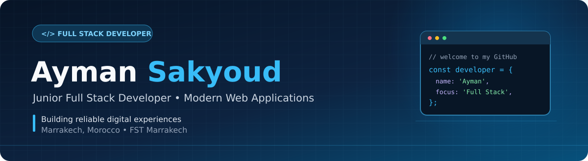

 

 

**Junior Full Stack Developer | Modern Web Applications**

Backend Engineering · Clean Interfaces · Scalable Applications

---

## `01 / About Me`

<table>
<tr>
<td width="60%" valign="top">

<h3>Hi, I'm Ayman Sakyoud</h3>

A <strong>Junior Full Stack Developer</strong> based in
<strong>Marrakech, Morocco</strong>, with a degree in
<strong>Systèmes Informatiques Répartis (SIR)</strong>
from <strong>FST Marrakech</strong>.

I enjoy designing and building complete web applications,
from REST APIs and relational databases to responsive
frontend interfaces and deployment.

<b>Focus:</b> Django, Django REST Framework, React, PostgreSQL

<b>Interests:</b> Software Architecture, API Security, DevOps

<b>Exploring:</b> Docker, CI/CD, Cloud Deployment

<b>Open to:</b> Junior Developer Opportunities and Collaboration

</td>
<td width="40%" valign="top">

<pre>
<code>
developer:
  name: Ayman Sakyoud
  role: Junior Full Stack
  location: Marrakech
  education: FST Marrakech

focus:
  - Backend Development
  - REST API Design
  - Frontend Development
  - Database Management

learning:
  - Docker
  - CI/CD
  - Cloud Deployment
</code>
</pre>

</td>
</tr>
</table>

---

## `02 / Featured Projects`

<table>
<tr>
<td width="50%" valign="top">

<h3>SmartSchool</h3>

<strong>Academic Management Platform</strong>

A connected academic ecosystem providing
student management, grades, reports,
role-based access and an AI assistant for parents.

</td>
<td width="50%" valign="top">

<h3>Django CRM</h3>

<strong>Customer Relationship Management</strong>

A customer management application featuring
authentication, lead tracking, customer records,
and management dashboards.

</td>
</tr>

<tr>
<td width="50%" valign="top">

<h3>Java Swing Cooperative</h3>

<strong>Desktop Management Application</strong>

Desktop software for managing cooperative
members, administrative operations,
and generating dynamic reports.

</td>
<td width="50%" valign="top">

<h3>Student CRUD</h3>

<strong>Student Management System</strong>

A web application for managing student
information with complete create, read,
update and delete functionality.

</td>
</tr>
</table>

---

## `03 / Tech Stack & Tools`

### Programming Languages

  

### Frameworks & Web Development

 

 

### Database Management

 

 

### Development Tools

---

## `04 / GitHub Statistics`

  

  

---

## `05 / Currently Learning`

---

## `06 / Portfolio`

Discover my projects, technical skills, and web development work.

---

## `07 / Let's Connect`

### Have an idea or a project in mind?

I'm always interested in collaborating, learning, and exploring new development opportunities.

 

  

**Thanks for visiting my GitHub profile.**

Building modern web applications with precision and passion.

